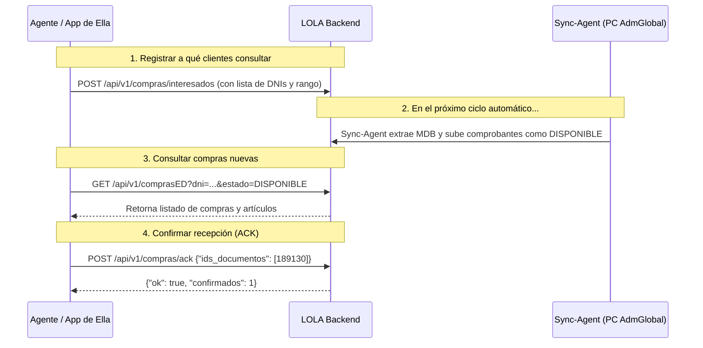

# Guía de Integración: API comprasED & Targeted Sync

Documentación técnica para agentes y desarrolladores de **Ella** para interactuar con el módulo de compras y sincronización bajo demanda.

---

## 1. Conceptos Clave y Filosofía

1. **Sincronización Bajo Demanda (Targeted Sync):** El backend no expone masivamente comprobantes de toda la empresa. Solo sincroniza las compras de los clientes cuyos DNIs hayan sido registrados como interesados.
2. **Máquina de Estados y ACK (Anti-duplicados):**
   * Cuando se sincronizan compras nuevas, quedan en estado `DISPONIBLE`.
   * Al ser leídas y guardadas en la app/Firebase de Ella, se envía un `ACK` que las pasa a estado `PROCESADO`.
   * En consultas posteriores con `estado=DISPONIBLE`, no se repiten comprobantes ya procesados.
3. **Autenticación:** Todas las llamadas de Ella requieren el header HTTP:
   ```http
   x-api-key: <COMPRAS_API_KEY>
   ```

**URL Base de Producción:**  
`https://lola-backend.elladecide.workers.dev`

---

## 2. Flujo de Integración Paso a Paso



---

## 3. Especificación de Endpoints

### A. Registrar Clientes Interesados
Informa qué DNIs deben ser sincronizados y con qué ventana temporal.

* **Endpoint:** `POST /api/v1/compras/interesados`
* **Headers:**
  * `Content-Type: application/json`
  * `x-api-key: <COMPRAS_API_KEY>`
* **Body:**
  ```json
  {
    "dnis": ["32685684", "39675372"],
    "rango": "48h"
  }
  ```
  * `rango` (opcional): `"48h"` (default), `"7d"`, `"1m"`, o `"personalizada"`.
  * Si es `"personalizada"`, podés agregar `"desde": "2026-10-01"`, `"hasta": "2026-10-31"`.
* **Respuesta (200 OK):**
  ```json
  {
    "ok": true,
    "procesados": 2,
    "rango_configurado": "48h"
  }
  ```

---

### B. Consultar Compras de un Cliente (`comprasED`)
Recupera el historial de compras y los artículos comprados por el cliente.

* **Endpoint:** `GET /api/v1/comprasED?dni={DNI}&estado={ESTADO}&rango={RANGO}&limit={LIMIT}`
* **Headers:**
  * `x-api-key: <COMPRAS_API_KEY>`
* **Query Params:**
  * `dni` (requerido): DNI o CUIT del cliente (limpia espacios, puntos y guiones automáticamente).
  * `estado` (opcional): `"DISPONIBLE"` (recomendado para traer solo compras no leídas) o `"PROCESADO"`. Si se omite, trae todos.
  * `rango` (opcional): `"48h"`, `"7d"`, `"1m"`, `"personalizada"`.
  * `desde` / `hasta` (opcional): Filtro por fecha ISO si `rango=personalizada`.
  * `limit` (opcional, default `50`, máx `200`).
* **Respuesta (200 OK):**
  ```json
  {
    "dni": "32685684",
    "total_compras": 1,
    "estado_filtrado": "DISPONIBLE",
    "rango_filtrado": "48h",
    "compras": [
      {
        "id_documento": 189130,
        "dni": "32685684",
        "fecha": "2026-09-03T20:22:02",
        "tipo_doc": "Ticket B",
        "total": 97207.8,
        "estado": "DISPONIBLE",
        "revision": 1,
        "items": [
          {
            "codigo_unico": "KAUP160",
            "descripcion": "KAURY P160 PACKS CULOTTE LESS ALGODON",
            "cantidad": 1.0,
            "precio_unitario": 10891.49,
            "subtotal": 10891.49
          },
          {
            "codigo_unico": "BOX2000",
            "descripcion": "BOXER BAKHOU 2000 LISO ALGODON HOMBRE",
            "cantidad": 1.0,
            "precio_unitario": 8907.53,
            "subtotal": 8907.53
          }
        ]
      }
    ]
  }
  ```

---

### C. Confirmar Lectura / Procesamiento (ACK)
Una vez que el agente/app procesó y guardó los comprobantes, envía sus IDs para marcarlos como `PROCESADO`.

* **Endpoint:** `POST /api/v1/compras/ack`
* **Headers:**
  * `Content-Type: application/json`
  * `x-api-key: <COMPRAS_API_KEY>`
* **Body:**
  ```json
  {
    "ids_documentos": [189130]
  }
  ```
* **Respuesta (200 OK):**
  ```json
  {
    "ok": true,
    "confirmados": 1
  }
  ```

---

## 4. Ejemplos de Implementación para un Agente / Script

### cURL
```bash
# 1. Registrar interesado
curl -X POST "https://lola-backend.elladecide.workers.dev/api/v1/compras/interesados" \
  -H "Content-Type: application/json" \
  -H "x-api-key: TU_COMPRAS_API_KEY" \
  -d '{"dnis": ["32685684"], "rango": "48h"}'

# 2. Consultar compras nuevas disponibles
curl -X GET "https://lola-backend.elladecide.workers.dev/api/v1/comprasED?dni=32685684&estado=DISPONIBLE" \
  -H "x-api-key: TU_COMPRAS_API_KEY"

# 3. Confirmar procesamiento (ACK)
curl -X POST "https://lola-backend.elladecide.workers.dev/api/v1/compras/ack" \
  -H "Content-Type: application/json" \
  -H "x-api-key: TU_COMPRAS_API_KEY" \
  -d '{"ids_documentos": [189130]}'
```

### TypeScript / Fetch
```typescript
const BASE_URL = 'https://lola-backend.elladecide.workers.dev';
const API_KEY = process.env.COMPRAS_API_KEY!;

// Consultar compras pendientes
async function obtenerComprasNuevas(dni: string) {
  const res = await fetch(`${BASE_URL}/api/v1/comprasED?dni=${dni}&estado=DISPONIBLE`, {
    headers: { 'x-api-key': API_KEY },
  });
  if (!res.ok) throw new Error(`HTTP ${res.status}`);
  return await res.json();
}

// Confirmar recepción
async function confirmarCompras(ids: number[]) {
  const res = await fetch(`${BASE_URL}/api/v1/compras/ack`, {
    method: 'POST',
    headers: {
      'Content-Type': 'application/json',
      'x-api-key': API_KEY,
    },
    body: JSON.stringify({ ids_documentos: ids }),
  });
  return await res.json();
}
```
