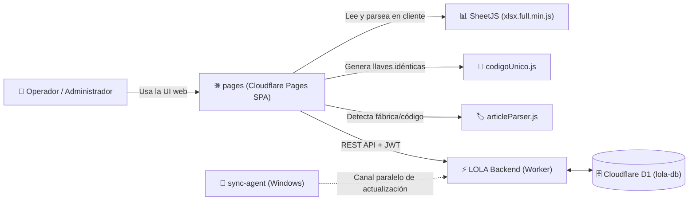

# LOLA — Panel de catálogo (Cloudflare Pages)

Web estática para administrar el catálogo de LOLA. **La página es la generadora**:
lee el Excel (SheetJS), calcula las 4 listas y genera `codigo_unico` en el
navegador (`codigoUnico.js`, port EXACTO del backend). El Worker es el mensajero
que **reemplaza** el catálogo con backup rotativo.

## 🗺️ Mapa de Dependencias del Ecosistema



### ¿De quién depende `pages`?
1. **[`backend/`](file:///c:/Users/elladecide2/Documents/GitHub/elladecide-sde9/backend/README.md):** Es su único servicio backend. `pages` no tiene base de datos propia; consume endpoints REST protegidos por JWT:
   * `POST /api/v1/auth/login`: Autenticación.
   * `GET /api/v1/sync/v2`: Lectura del inventario para la tabla y buscador.
   * `POST /api/v1/admin/products`: Guardado de ediciones y subida masiva de catálogo (`replace: true`).
   * `POST /api/v1/admin/rollback`: Restauración de emergencia a la versión previa.
2. **Bibliotecas locales sin dependencias externas:**
   * `xlsx.full.min.js`: Para leer y procesar hojas de cálculo Excel directamente en la memoria del navegador.
   * `codigoUnico.js`: Port 1:1 de la función TypeScript del backend para garantizar unicidad y estabilidad de claves primarias.
   * `articleParser.js`: Módulo ESM para inferir fábrica, código y ofertas desde la descripción del producto.
3. **Cloudflare Pages:** Plataforma de hosting serverless estático (HTML/CSS/JS plano sin bundler complejo).

### ¿Quiénes dependen de `pages`?
* **Los dueños y operadores del comercio:** Es el único panel visual con buscador fuzzy, edición rápida de precios y visor de inventario.
* **El catálogo en la nube:** Cuando el operador edita un producto o sube un Excel corregido desde `pages`, se actualiza la versión en D1 y todos los dispositivos (como el teclado Android) se actualizan automáticamente.

---

## Secciones

El panel es una SPA con 4 tabs (visibles solo con sesión iniciada):

| Tab | Qué hace |
| --- | --- |
| **📦 Inventario** | Catálogo completo, buscador fuzzy, editar y eliminar artículos |
| **📂 Catálogo** | Excel → columnas → generar → subir (replace) + rollback |
| **⚙️ Configuración** | Precios (IVA/factores), modo de sync y contraseña |
| **🗂️ Administración** | Parser de artículos (fábrica · código · oferta) + completar el catálogo |

### Inventario

- Lee `GET /api/v1/sync/v2` (una sola vez; se reutiliza al volver a la tab) y
  pagina el listado de a 120 filas.
- **Buscador fuzzy token por token**: la query se parte por espacios y *todos*
  los tokens tienen que pegar (AND), en cualquier orden. Normaliza a minúsculas
  y sin acentos. Por token:
  1. substring sobre `codigo_unico + descripción + categoría + fábrica + código`
     (bonus si arranca una palabra → "cocina" pega antes en "cocina express");
  2. si no, tolerancia a typos contra palabras sueltas: Levenshtein con corte
     ≤ 1 error (tokens ≥ 4 letras) o ≤ 2 errores (≥ 7 letras) →
     "express" pega en "espresso", "cafetra" en "cafetera";
  3. si no, el token descarta el artículo.
- Las filas muestran categoría · fábrica · código y, si está en oferta, el tag
  🔥 OFERTA; además los chips **Costo neto** y **Costo+IVA**.
- **Editar** → modal con descripción, **Costo neto** y **Costo + IVA**
  editables (cada campo manda sobre el otro con el IVA de la config), L1..L4
  con un botón **R** por lista (recalcula ESA lista desde el costo; title
  `recalcular` + leyenda debajo), categoría, fábrica, **código de fábrica** y
  checkbox **Oferta**. Tildar Oferta iguala las 4 listas a la L4 (la oferta
  manda los precios). Los costos se guardan con `POST /api/v1/admin/products`
  (**upsert parcial**, sin `replace`).
  Botón "↺ Recalcular L1..L3 desde el costo". Tocar la L4 sigue derivando los
  costos, salvo que se hayan editado a mano (ahí manda el costo).
- **Eliminar** → `DELETE /api/v1/admin/products/:codigo_unico`.
- Ambas acciones suben la revisión: las apps se resincronizan solas.
- Si el modo de sync es `descripcion-costos`, v2 no trae código ni metadatos →
  el inventario cae al contrato v1 (solo lectura + borrado) y **bloquea la
  edición** para no pisar categoría/fábrica con strings vacíos.

### Administración

`articleParser.js` es **ESM puro** (el mismo archivo que importa el proyecto
React). `index.html` lo carga con un `<script type="module">` que lo expone en
`window.LolaParser` para que `app.js` (clásico, sin bundler) lo use:

- **🔍 Analizar inventario** → corre `parseArticles()` sobre las descripciones
  del catálogo y muestra: chips por fábrica (`summarizeFabricas`), stats
  (filas / con fábrica detectada / sin marca → SIN FABRICA / ofertas / a
  revisar) y una tabla con los
  4 campos del payload: **fábrica, código, descripción y oferta**. Las filas con
  confianza baja salen marcadas con ⚠️.
- **✅ Completar** → `POST /api/v1/admin/products` (upsert parcial) con los
  artículos a los que les falta **fábrica y/o código**; nunca pisa lo ya
  cargado. Las filas sin marca detectada se completan con **SIN FABRICA**:
  **ningún artículo queda sin fábrica** (el backend también la impone en todo
  write, así ningún cliente puede dejarla vacía). Las ofertas detectadas
  igualan las 4 listas a la L4 (la oferta manda los precios) y **los costos ya
  guardados se conservan** (solo se derivan de la L4 si faltan). Sube la
  revisión: las apps se resincronizan solas. Bloqueado si el modo de sync es
  `descripcion-costos` (v1 no trae categoría → se pisaría con vacío).

## Generación y subida

1. Elegís el Excel de precios (`.xlsx`/`.xls`).
2. Configurás columnas (nombre, precio, código, categoría, fábrica) y filas de header.
3. En **Configuración** ajustás **Precios**: IVA %, factor inverso de la L4 y los
   factores de L1..L3 (persisten en `localStorage`; defaults 21 / 50 / 2,32 /
   2,12 / 1,65).
4. En **Configuración** elegís el **Modo de sync** (`predeterminado` o
   `descripcion-costos`) → `POST /api/v1/admin/sync-config`; el worker lo guarda
   en `config` y queda para `GET /api/v1/sync/v2`.
5. **Generar catálogo** → parsea en el navegador, calcula costo neto, costo+IVA
   y las 4 listas, y genera `codigo_unico` (misma regla que el CLI:
   `abrev(marca) + modelo`). Además corre `articleParser.js` sobre cada nombre
   y completa **fábrica** y **código** (si el Excel no los trae; sin marca
   detectada queda **SIN FABRICA**) y decide la **oferta**.
6. **Subir a la nube** → `POST /api/v1/admin/products` con
   `{ products, replace: true }` → el Worker hace backup rotativo + borra +
   inserta, atómico.

La lógica de precios es un port 1:1 de `backend/src/modelo.ts`:

```
costo+IVA  = Lista 4 / (1 + inversa/100)          (inversa 50 → /1,50)
costo neto = (costo + IVA) / (1 + IVA/100)        (IVA 21 → /1,21)
Lista n    = round(costo neto × (1 + IVA/100) × factor_n)
```

IVA y factores vienen de la config (no están hardcodeados). **Oferta = unión de
ambas detecciones** (la que más certera): los sufijos de siempre (el nombre
termina en `.`, `oferta` o `liq`) **y** las marcas del parser (PROMO, REMATE,
SALDOS, OUTLET, DESCUENTO…). Si es oferta → las 4 listas iguales al precio del
Excel. El backend (`importCatalogo.ts`) aplica la MISMA regla, así el CLI y la
web deciden igual.

La vista previa muestra las **primeras 10 filas** del modelo (Código, Descripción,
Costo neto, Costo+IVA, L1..L4) — la lista completa y editable está en
**Inventario**. La subida manda el modelo completo
(`codigo_unico`, `descripcion`, `costo_neto`, `costo_iva`, `precios`,
`categoria`, `fabrica`, `codigo`, `oferta`) — el worker acepta también el shape
viejo (`nombre` + `precios`) por compatibilidad.

## Una sola forma

- `pages/codigoUnico.js` y `backend/src/codigoUnico.ts` están verificados en
  **paridad exacta** (mismos códigos sobre el catálogo real). NO tocar uno sin
  el otro.
- Fallback: `POST /api/v1/admin/import` (el Worker calcula si mandás las filas).
- Último recurso: parseo local (CLI `npm run import`).

## Requisito previo: credenciales JWT

El Worker administra en modo **fail-closed**: sin `JWT_SECRET` configurado no
acepta subidas. La web primero hace `POST /api/v1/auth/login` y guarda el token
en `localStorage`.

```bash
cd backend
npx wrangler secret put ADMIN_USER
npx wrangler secret put ADMIN_PASSWORD
npx wrangler secret put JWT_SECRET
```

## Correr local

```bash
npx serve pages          # o cualquier server estático
```

## Deploy a Cloudflare Pages

```bash
npx wrangler pages deploy pages --project-name=lola-catalogo
```

URL: `https://lola-catalogo.pages.dev`.

## Estructura

```
pages/
├── index.html        ← UI: login + tabs (Inventario / Catálogo / Config / Admin) + modal de edición
├── codigoUnico.js    ← regla de codigo_unico (port 1:1 del backend)
├── articleParser.js  ← parser de artículos ESM (fábrica/código/oferta) — expuesto vía window.LolaParser
├── app.js            ← login + navegación + inventario/buscador + precios + subida + admin
├── styles.css        ← tema oscuro LOLA
└── xlsx.full.min.js  ← SheetJS (copiado de la extensión)
```